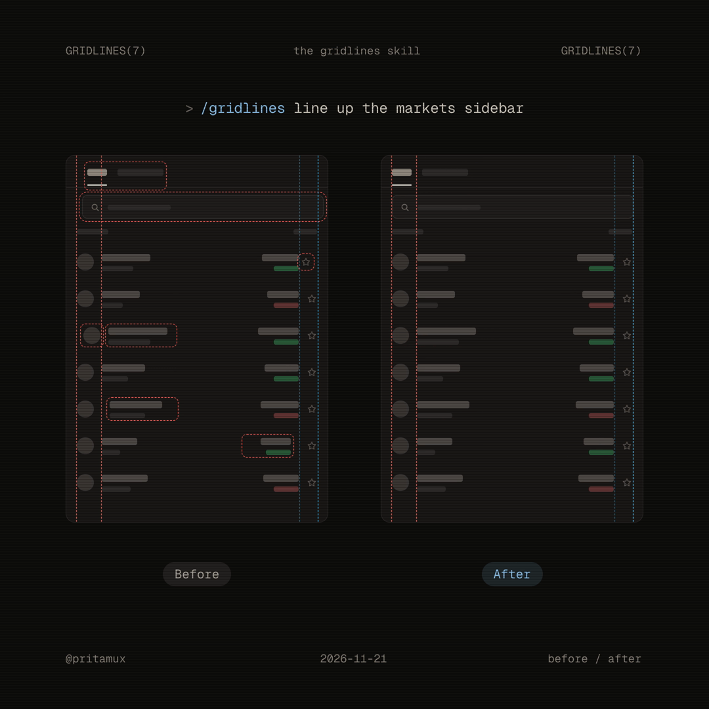
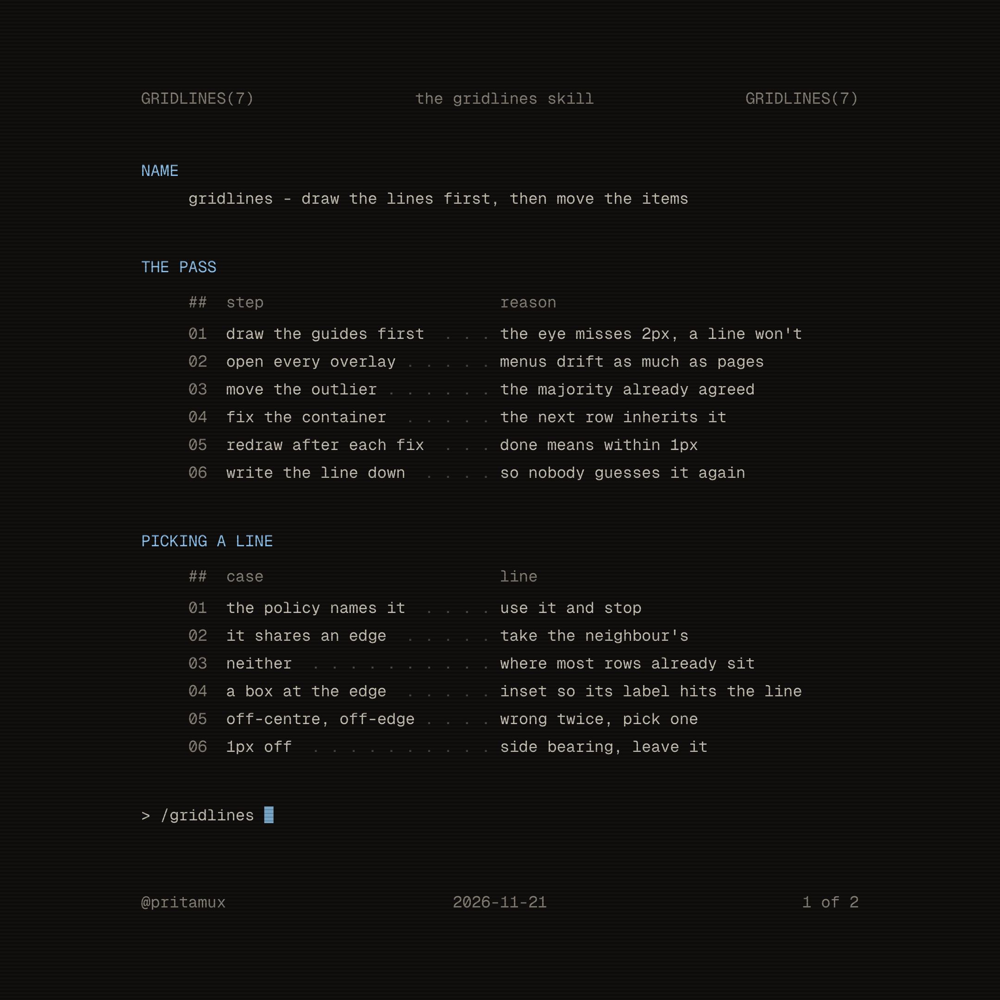
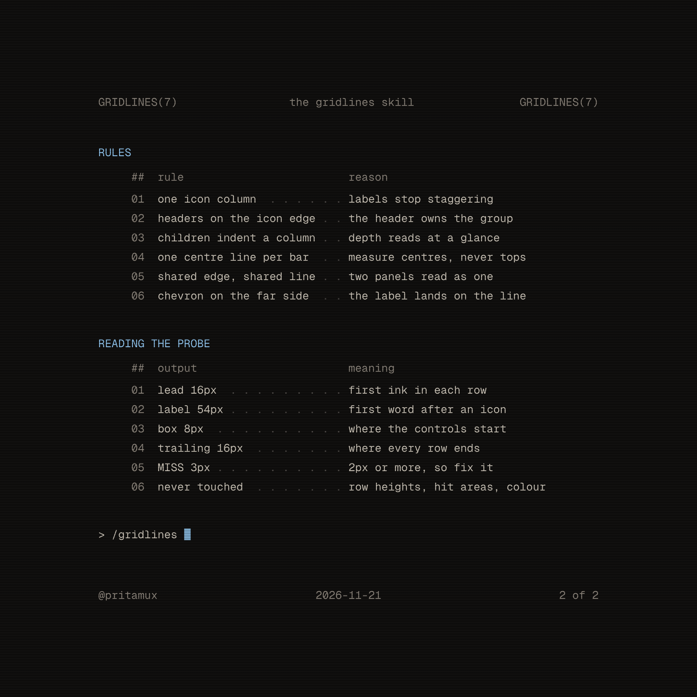

# gridlines

An agent skill for alignment passes. It draws vertical guide lines down an interface, finds every item that misses its line, and fixes the padding so sidebars, toolbars, panels, menus and tables share a small set of edges.

Draw the lines first, then move the items.

[](media/before-after.mp4)

## Install

```sh
npx skills add pritamux/gridlines
```

Or copy `skills/gridlines/` into your agent's skills folder (for Claude Code, `~/.claude/skills/gridlines/`).

Then ask your agent for an alignment pass, or call it directly:

```
/gridlines line up the settings sidebar
```

## What's inside

| File | What it does |
| --- | --- |
| `skills/gridlines/SKILL.md` | The process and the rules the agent follows |
| `skills/gridlines/probe.js` | Runs in the page: measures the ink edges of text, icons and controls, draws the guides, lists every miss |
| `skills/gridlines/audit.mjs` | Loads a page in headless Chromium, runs the probe, saves a 2x capture with the guides and a JSON report |
| `examples/sidebar.html` | A sidebar with four planted misses, to see a report before pointing it at your app |
| `examples/card-gallery.html` | A responsive gallery with one deliberately oversized desktop gap |

## Try the probe

The audit script needs Playwright. Install it anywhere and point `PW_DIR` at that folder:

```sh
npm i --prefix /tmp/gridlines-pw playwright
npx --prefix /tmp/gridlines-pw playwright install chromium
PW_DIR=/tmp/gridlines-pw node skills/gridlines/audit.mjs "file://$PWD/examples/sidebar.html" .gridlines 800
```

```
## Sidebar  x0 w240
   lead 12px  box -  icon centre 20px  label 36px  trailing 12px  trailing centre -
   MISS y56 trailing: 15px vs 12px  [12]
   MISS y88 leading: 15px vs 12px  Workspace
   MISS y120 label: 38px vs 36px  Views
   MISS y120 vertical-centre: 3px vs 0px  <svg> … Views
```

The probe also works without the script: paste `probe.js` into any page's console and call `window.__gridlines()`.

### Check gaps between cards

Pass a `spacing` array to check the rendered gaps between direct children of selected containers. Set `row` (vertical), `column` (horizontal), or both, in CSS pixels. A difference greater than 1 px is a miss. A single-column group has no horizontal gaps to check.

```js
window.__gridlines({
  spacing: [
    { selector: ".gallery", row: 20 },
    { selector: ".cards", row: 20, column: 20 },
  ],
})
```

For the same check in the headless script, set `SPACING` to the JSON array of rules. The example reports a 32 px gap between the groups at 1440 px (expected 20 px) even though the gallery's CSS `gap` is set to 20 px. At 390 px, use `row: 10` to match the gallery's mobile spacing. The JSON includes the measured gaps and the screenshot marks any gap misses in magenta.

```sh
SPACING='[{"selector":".gallery","row":20},{"selector":".cards","row":20,"column":20}]' \
  PW_DIR=/tmp/gridlines-pw node skills/gridlines/audit.mjs "file://$PWD/examples/card-gallery.html" .gridlines 1440
```





## Credits

The rules come from Karri Saarinen's redraw of the Linear sidebar and his notes on rhythm, edges and centring, backed by the layout chapter of Apple's Human Interface Guidelines.

## License

MIT
